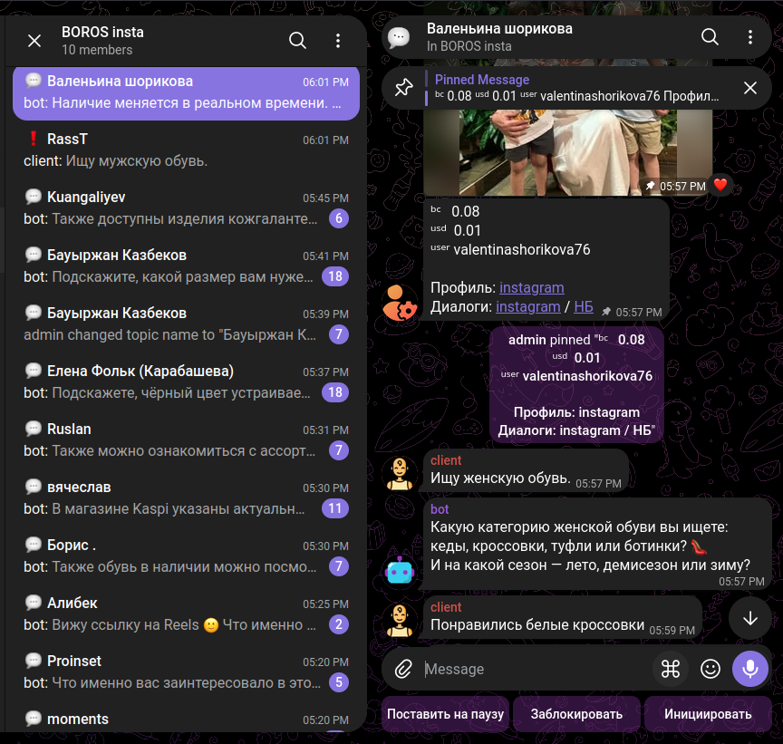

# Nextbot ↔ Telegram Integration

Интеграция для существующего агента **Nextbot**, позволяющая синхронизировать диалоги агента с отдельной группой Telegram.

Telegram-группа должна поддерживать режим **«Темы» (Topics)**. Каждый диалог агента отображается в виде отдельной темы группы.

Для наглядного отображения отправителей используются отдельные Telegram-боты, представляющие различные роли:

- **client** — пользователь;
- **manager** — оператор;
- **bot** — AI-агент (LLM).

## Возможности

### Управление синхронизацией

1. Управление общей синхронизацией из главной темы (General Topic):
   - запуск;
   - перезапуск;
   - остановка.

### Управление ботом

2. Управление активностью бота в конкретном диалоге:
   - пауза;
   - блокировка.

### Работа с сообщениями

3. Отправка пользователю сообщений из соответствующей темы Telegram:
   - текст;
   - аудио;
   - фотографии.
4. Инициация нового сообщения от имени бота в отдельном диалоге.

## Особенности

- **Независимость.** Интеграция не влияет на остальную работу агента.
- **Визуальные статусы.** Эмодзи темы отражает состояние диалога:
  - ❗️ — диалог на паузе;
  - 🏴‍☠️ — диалог заблокирован.
- **Быстрый переход к диалогу.** В пользовательскую переменную `topic_url` сохраняется ссылка на соответствующую тему Telegram. Её можно использовать в уведомлениях операторам для быстрого перехода к диалогу.
- **Информационное сообщение.** Первым сообщением в каждой теме закрепляется информационная карточка, содержащая:
  - расход токенов;
  - имя пользователя в мессенджере;
  - ссылку на диалог в мессенджере;
  - ссылку на диалог в Nextbot;
  - для Avito — дополнительную информацию и ссылку на объявление.
- **Автоматический перевод.** Сообщения на казахском языке автоматически переводятся на русский.

---

# Установка и настройка

## 1. Подготовка Telegram-группы

1. Создать Telegram-группу.
2. Включить режим «Темы» (Topics).
3. Закрепить главную тему (General Topic).

## 2. Создание Telegram-ботов

Создать следующих Telegram-ботов:

| Бот | Назначение |
|---|---|
| `admin` | Администрирование группы |
| `client` | Сообщения пользователей |
| `manager` | Сообщения операторов |
| `bot` | Сообщения AI-агента |
| `project` | Системные уведомления |

Добавить всех ботов в Telegram-группу.

Боту `admin` предоставить права администратора.

> Примечание: боты `project` и `admin` могут быть одним и тем же ботом.

## 3. Настройка вебхука Nextbot

В агенте создать вебхук с адаптером.

Код вебхука:

[`webhook/webhook.py`](webhook/webhook.py)

## 4. Создание сценариев

Создать сценарии согласно схеме:


Код сценариев находится в директории:

[`scenarios/`](scenarios/)

## 5. Создание пользовательских переменных

Создать пользовательские переменные согласно схеме:


---

# Конфигурация

Для настройки интеграции необходимо заполнить пользовательскую переменную `configuration`.

Остальные переменные используются интеграцией автоматически.

Пример конфигурации:

```json
{
  "chat_id": {
    "value": "-10043271...",
    "description": "Telegram-группа с темами, в которую пересылаются все сообщения агента"
  },
  "scenarios": {
    "init_scenario_id": 6,
    "stop_scenario_id": 7,
    "restart_scenario_id": 9,
    "checking_scenario_id": 5,
    "trigger_scenarios_ids": [
      1,
      2,
      3
    ]
  },
  "bots_token": {
    "admin": "90426...",
    "client": "92097...",
    "manager": "90579...",
    "assistant": "919010..."
  },
  "sub_agents": {
    "hashes": [
      "3c1c85d6-..."
    ],
    "description": "Дополнительные агенты, кроме основного, на случай возможности смены агента в ходе диалога"
  },
  "credentials": {
    "email": "...",
    "password": "..."
  },
  "main_dialog": {
    "id": 12345,
    "description": "Диалог для перезапуска основного сценария проверки новых сообщений и отображения сообщений оператора, поступивших из Telegram через вебхук. Должен совпадать с main_dialog_id, указанным в вебхуке агента"
  },
  "project_bot": {
    "error": {
      "chat_id": "-100435...",
      "topic_id": 2,
      "description": "Telegram-чат для уведомлений о критических ошибках. topic_id необязателен"
    },
    "token": "891913..."
  },
  "webhook_url": "https://app.nextbot.ru/api/webhooks/v1/4220a03...",
  "max_empty_iterations": {
    "qnty": 1,
    "description": "Количество обязательных пустых итераций проверки, после которых проверка останавливается и активируются триггеры новых сообщений"
  },
  "max_auto_restart_qnty": 3
}
```

## Описание параметров

| Параметр | Описание |
|---|---|
| `chat_id` | ID Telegram-группы с темами |
| `scenarios.init_scenario_id` | ID сценария запуска синхронизации |
| `scenarios.stop_scenario_id` | ID сценария остановки синхронизации |
| `scenarios.restart_scenario_id` | ID сценария перезапуска синхронизации |
| `scenarios.checking_scenario_id` | ID сценария проверки новых сообщений |
| `scenarios.trigger_scenarios_ids` | ID сценариев-триггеров новых сообщений |
| `bots_token` | Токены Telegram-ботов |
| `sub_agents.hashes` | Hash дополнительных агентов |
| `credentials` | Учетные данные для доступа к Nextbot |
| `main_dialog.id` | ID технического диалога для выполнения служебных сценариев |
| `project_bot.token` | Токен бота для системных уведомлений |
| `project_bot.error.chat_id` | ID чата для уведомлений об ошибках |
| `project_bot.error.topic_id` | ID темы для уведомлений об ошибках (необязательно) |
| `webhook_url` | URL вебхука Nextbot |
| `max_empty_iterations.qnty` | Количество пустых итераций проверки |
| `max_auto_restart_qnty` | Максимальное количество автоматических перезапусков |

---

# Дополнительные настройки и рекомендации

1. **ID сценариев.** ID сценариев отображаются, если для них не задано специальное наименование. Обычно ID соответствуют порядку создания сценариев.

2. **Технический диалог (`main_dialog`).**
   - Можно указать ID любого существующего диалога.
   - В нём будут запускаться все служебные сценарии.
   - Рекомендуется использовать отдельный тестовый диалог.
   - ID в `configuration.main_dialog.id` и `main_dialog_id` в вебхуке должны совпадать.

3. **Приоритет сценариев.** Если в агенте уже существуют другие сценарии, реагирующие на новые сообщения пользователя, оператора или агента, необходимо установить для триггерных сценариев интеграции более низкий приоритет.

4. **Первый запуск.** Для запуска синхронизации необходимо отправить команду `Старт` в главной теме Telegram-группы.

5. **Управление из Nextbot.** Если в качестве `main_dialog` назначен тестовый диалог, синхронизацией можно управлять непосредственно из его окна с помощью следующих команд:

   | Команда | Действие |
   |---|---|
   | `START_SYNC` | Запуск синхронизации |
   | `RESTART_SYNC` | Перезапуск синхронизации |
   | `STOP_SYNC` | Остановка синхронизации |
   | `STATUS_SYNC` | Проверка состояния синхронизации |

---

# Алгоритм работы

Синхронизация построена на событийной модели с периодической проверкой новых сообщений.

### 1. Обнаружение нового сообщения

При появлении нового сообщения в агенте срабатывают сценарии-триггеры.

### 2. Запуск проверки

Первый сработавший сценарий-триггер:

- отключает остальные сценарии-триггеры;
- запускает сценарий проверки новых сообщений.

Это предотвращает параллельное выполнение нескольких проверок.

### 3. Получение и обработка сообщений

Сценарий проверки:

1. Читает из пользовательской переменной `state` последнее ранее обработанное сообщение.
2. Получает список сообщений агента.
3. Определяет новые, ещё не обработанные сообщения.
4. Пересылает их в соответствующую тему Telegram.
5. Обновляет состояние обработки сообщений.

### 4. Повторная проверка

После отправки новых сообщений проверка повторяется с интервалом в одну минуту.

Количество дополнительных пустых итераций определяется параметром:

```json
{
  "max_empty_iterations": {
    "qnty": 1
  }
}
```

### 5. Завершение проверки

Если новые сообщения отсутствуют в течение заданного количества пустых итераций:

- очищается контекст технического диалога `main_dialog`;
- повторно активируются сценарии-триггеры;
- интеграция ожидает появления новых сообщений.

Таким образом, система возвращается в режим ожидания событий и готова обработать следующую активность в диалогах.

---

# Пример внешнего вида

