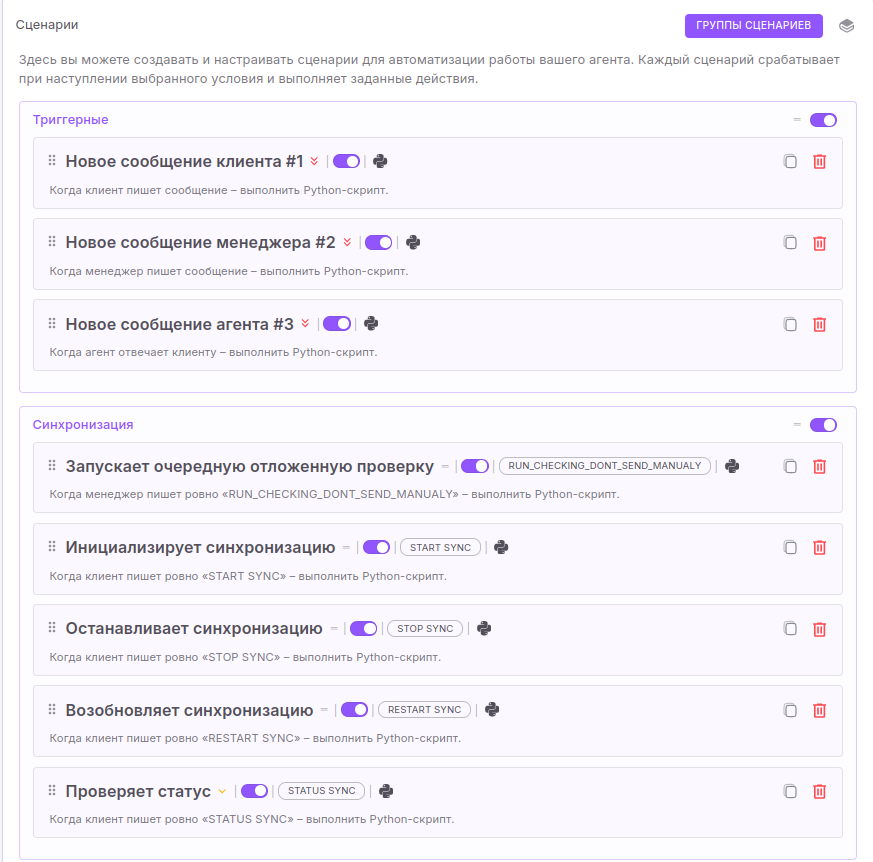
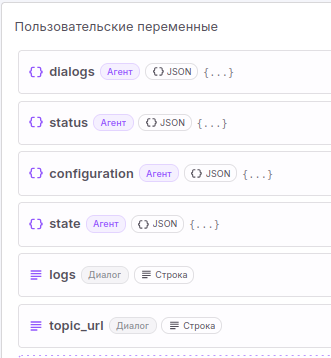

Интеграция для существующего агента Nextbot, позволяющая синхронизировать диалоги агента в отдельную телеграм группу.
Телеграмм группа должна иметь настройку разбивки сообщений по темам (topics), что позволяет представить отдельный диалог агента в виде отельной темы телеграм группы.
Роли сообщений (пользователь, оператор, llm) представлены в каждом топике отдельным телеграм ботом (client, manager, bot), что наглядно показывает отправителя.

Функционал интеграции позволяет:
1. управлять активностью синхронизации (старт, рестарт, стоп) из главной темы (General topic)
2. управлять активностью бота в конкретном диалоге (пауза, блок) из соответствующей темы
3. отправлять мессенджер пользователю текстовые сообщения, аудио и фото файлы из соответствующей темы
4. инициировать сообщение бота в отдельном диалоге из соответствующей темы

Особенности:
1. интеграция не влияет на остальную работу агента
2. эмодзи темы отражает статус диалога (️❗️- на паузе, 🏴‍☠️ - заблокирован)
3. в переменную диалога topic_url сохраняется ссылка на тему, которую можно использовать в уведомлениях оператору, что позволяет переходить в диалог из других сообщений, сформированных агентом
4. первым в теме закрепляется информационное сообщение о диалоге (расход токенов, имя в мессенджере, ссылки на диалог в мессенджере и Некстбот, для авито еще выводятся данные и ссылки объявления)
5. сообщения на казахском языке автоматически переводятся на русский язык

Порядок сборки:
1. Создать телеграм группу, включить темы, закрепить главную тему (General topic)
2. Создать телеграм ботов с именами admin, client, manager, bot, project. Добавить ботов в группу. admin боту предоставить права администратора.
3. В агенте создать вебхук с адаптером. Код вебхука [webhook.py](webhook/webhook.py)
4. Создать сценарии согласно скрину . Код сценариев [scenarios](scenarios)
5. Создать пользовательские переменные согласно скрину 

Настройка:
1. Заполнить соответствующими значениями только переменную configuration:
{
  "chat_id": {
    "value": "-10043271...",
    "description": "Телеграм группа с топиками, в которую пересылаются все сообщения агента"
  },
  "scenarios": {
    "init_scenario_id": 6,
    "stop_scenario_id": 7,
    "restart_scenario_id": 9,
    "checking_scenario_id": 5,
    "trigger_scenarios_ids": [
      1,
      2,
      3
    ]
  },
  "bots_token": {
    "admin": "90426...",
    "client": "92097...",
    "manager": "90579...",
    "assistant": "919010..."
  },
  "sub_agents": {
    "hashes": [
      "3c1c85d6-..."
    ],
    "description": "Агенты, помимо основного, в случае возможности смены агента в ходе диалога"
  },
  "credentials": {
    "email": "...",
    "password": "..."
  },
  "main_dialog": {
    "id": 12345,
    "description": "Диалог, в котором будет перезапускаться основной сценарий проверки на новые сообщения в агенте и отображаться сообщения оператора, поступившие из телеграм группы через вебхук. Должен совпадать с main_dialog_id, указанном в вебхуке агента"
  },
  "project_bot": {
    "error": {
      "chat_id": "-100435...",
      "topic_id": 2,
      "description": "Куда уведомлять при возникновении критических ошибок. topic_id опционален."
    },
    "token": "891913..."
  },
  "webhook_url": "https://app.nextbot.ru/api/webhooks/v1/4220a03...",
  "max_empty_iterations": {
    "qnty": 1,
    "description": "Количество обязательных порожних итераций, после которых будет остановлен проверка и включены триггеры на новые сообщения"
  },
  "max_auto_restart_qnty": 3
}
2. Моменты:
- id сценариев видны, когда не установлено специальное наименование сценария. Обычно совпадает с порядком создания.
- id для main_dialog можно указывать любой существующий. В нем будут вызываться все сценарии. Рекомендуется указать id тестового диалога. id, указанный в configuration и webhook должны совпадать.
- при наличии других сценариев на новое сообщение пользователя/оператора/агента - установить низший приоритет для триггерных сценариев.
- первый запуск: из телеграм группы из главной темы отправить "Старт".
- при назначении тестового диалога в качестве main_dialog синхронизацией можно управлять из окна тестового диалога, отправляя соответствующие команды (START_SYNC, RESTART_SYNC, STOP_SYNC, STATUS_SYNC)
- project и admin боты могут быть одним ботом

Алгоритм:
- при появлении в агенте нового сообщения срабатывают триггерные сценарии
- первый сработавший триггерный сценарий отключает все триггерные сценарии и вызывает проверку новых сообщений
- проверка новых сообщений: читает сохраненное ранее последнее обработанное сообщение из пользовательской переменной state, получает все сообщения агента, определяет не обработанные сообщения, пересылает их в телеграм.
- после пересылки новых сообщений проверка повторяется max_empty_iterations раз с интервалом в минуту
- при отсутствии новых сообщений удаляется контекст в main_dialog, активируются триггерные сценарии

